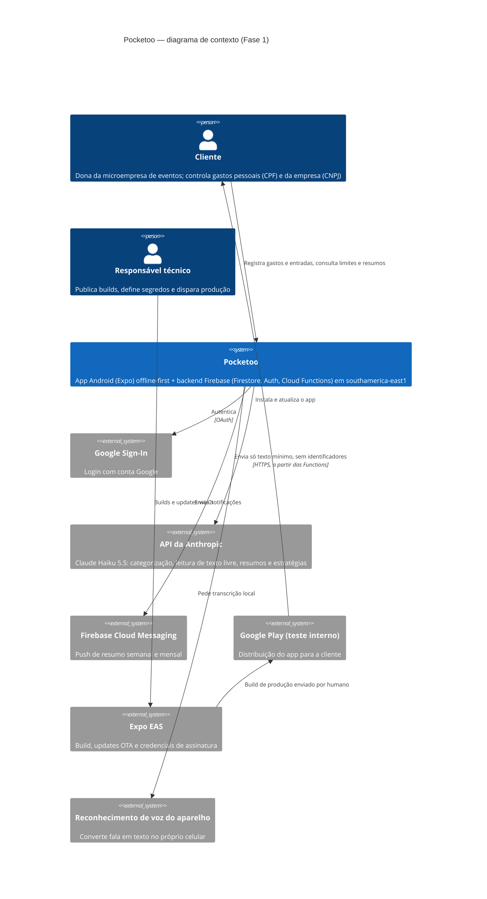

# Pocketoo — C4 nível 1 (contexto)

Fronteiras de confiança: o app no aparelho é não confiável (Rules e App Check protegem o backend); a API da Anthropic recebe só o necessário e sua saída é validada antes de qualquer uso.
